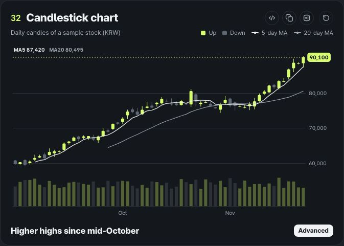
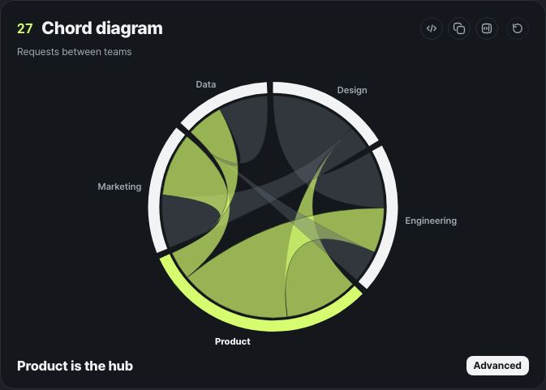
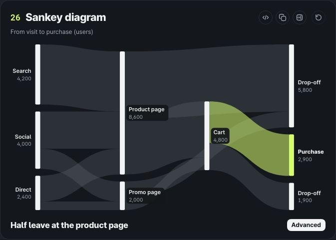

# ztd charts

English · [한국어](README.ko.md)

33 animated, interactive charts for React. Pure SVG, zero runtime dependencies. Draw from a single JSON spec, and let AI use it right away through the CLI, the MCP server and the agent skill.

Site: [charts.ztd.app](https://charts.ztd.app/) · Docs and gallery: [charts.ztd.app/docs](https://charts.ztd.app/docs/)

Renamed from `@junhanlee/chart-kit` in 0.2.0. Install `ztd-charts` (and `ztd-charts-cli`, `ztd-charts-mcp`), and change CSS names from `--ck-*`, `.ck-*` and `data-ck-theme` to `--ztd-*`, `.ztd-*` and `data-ztd-theme`.

<p>  </p>

- **One highlight tells the story.** Only the item you highlight gets the accent color; the rest stay neutral. Every card has a number, a title, a gray subtitle, a small square legend, a bold one-line takeaway and a level badge (Basic, Intermediate, Advanced).
- **Motion shows the reading order.** Charts sweep, fill and flow in when they scroll into view. When the data changes, they move on from where they are (a critically damped spring, so velocity carries over even mid-change).
- **Real data, right away.** Connect with field names or functions, load from a URL or an async function, and get loading, error and empty states along with it.
- **English and Korean.** English (en-US) by default. With `locale="ko-KR"` you get ko-KR number and date formats (1.2만, 3.4억, ₩5,000) and Korean chart text. Layout is tuned for Pretendard.
- **Accessible.** Keyboard navigation, screen reader descriptions and data tables, reduced motion, and WCAG AA for all text.

The two default themes use the same colors as the landing page. Dark (the default) has ink cards with a lime accent; light has white cards with a sky-blue accent.

## Contents

- [Install](#install) · [Quick start](#quick-start) · [33 charts](#33-charts) · [Cards and grid](#cards-and-grid)
- [Theme](#theme) · [Animation and interaction](#animation-and-interaction) · [Accessibility](#accessibility)
- [Connecting data](#connecting-data) · [JSON spec](#json-spec) · [CLI](#cli) · [MCP server](#mcp-server) · [AI skill](#ai-skill)
- [Docs site](#docs-site) · [Development](#development) · [QA results](#qa-results)

## Install

```bash
npm i ztd-charts
```

Requires React 18 or later. There are no other runtime dependencies. [Pretendard](https://github.com/orioncactus/pretendard) is the recommended font (without it, the system font is used).

## Quick start

```tsx
import { ChartCard, PieChart } from "ztd-charts";

const data = [
  { device: "Mobile", sales: 72 },
  { device: "Desktop", sales: 23 },
  { device: "Tablet", sales: 5 },
];

export function DeviceShare() {
  return (
    <ChartCard
      number="01"
      title="Pie chart"
      subtitle="Sales share by device"
      legend={[{ label: "Mobile", color: "accent" }, { label: "Desktop", color: "ink" }, { label: "Tablet", color: "neutral" }]}
      takeaway="Only 2 to 4 items"
      level="basic"
      replay
    >
      <PieChart data={data} label="device" value="sales" highlight="Mobile" />
    </ChartCard>
  );
}
```

With the same `data`, here is the chart as a JSON spec:

```tsx
import { Chart } from "ztd-charts";

<Chart
  spec={{
    type: "pie",
    data,
    encoding: { label: "device", value: "sales" },
    options: { highlight: "Mobile" },
    card: { number: "01", title: "Pie chart", subtitle: "Sales share by device", takeaway: "Only 2 to 4 items", level: "basic", legend: "auto" },
  }}
/>;
```

## 33 charts

We kept the forms that read well in reports and dashboards with "one highlight". Why each was chosen, and what was left out, is in [docs/catalog.md](docs/catalog.md).

| Group | Charts (`type` · component) |
|---|---|
| Proportion | `pie` PieChart · `donut` DonutChart · `waffle` WaffleChart · `marimekko` MarimekkoChart · `segmented` SegmentedBar |
| Hierarchy | `treemap` Treemap · `sunburst` SunburstChart |
| Flow | `funnel` FunnelChart · `sankey` SankeyChart · `chord` ChordChart |
| Comparison | `bar` BarChart · `waterfall` WaterfallChart · `pareto` ParetoChart · `radar` RadarChart · `slope` SlopeChart · `dumbbell` DumbbellChart · `lollipop` LollipopChart |
| Trend | `line` LineChart · `area` AreaChart · `stream` StreamGraph · `sparkline` Sparkline · `calendar` CalendarHeatmap · `bump` BumpChart · `candlestick` CandlestickChart |
| Distribution | `box` BoxPlot (box, violin) · `beeswarm` BeeswarmChart · `ridgeline` RidgelineChart |
| Relationship | `heatmap` Heatmap · `bubble` BubbleChart (scatter included) · `parallel` ParallelCoordinates |
| KPI | `gauge` GaugeChart (arc, semi, ring, ticks) · `bullet` BulletChart · `radialBar` RadialBarChart |

Each chart's props table and copyable code are on its page on the [docs site](https://charts.ztd.app/docs/). In a terminal: `npx ztd-charts-cli info <type>`.

The common props are the same for every chart.

| Prop | Description |
|---|---|
| `data` | An array of objects |
| `label`, `value`, `x`, `y`, `series`, `size`, `group`, `source`, `target`, `date` … | A field name (dot paths work) or `(d, i) => value` |
| `highlight` | The item to highlight. An index, a name, an array, `"max"`, `"min"`, `"first"`, `"last"`, `"none"` or a predicate function |
| `format`, `unit`, `locale` | `"number"`, `"integer"`, `"percent"`, `"ratio"`, `"compact"`, `"currency"`, `"decimal"` or Intl options. Default locale en-US; `"ko-KR"` switches to Korean formats and text |
| `height`, `width` | Width follows the parent (ResizeObserver) |
| `animate`, `duration`, `easing`, `stagger`, `replayKey`, `reducedMotion`, `animateOnView` | Animation |
| `onHover`, `onClick`, `tooltip`, `showLabels` | Interaction |
| `ariaLabel`, `description`, `theme`, `className`, `style` | Accessibility, styling |

Large data is handled for you. Line, area and sparkline reduce points with LTTB, while scatter (1,500 or more), heatmap (2,500 cells or more), beeswarm (2,000 or more), parallel coordinates (1,500 lines or more) and calendar (4,000 days or more) draw on canvas. Axes and labels stay SVG.

## Cards and grid

```tsx
import { ChartCard, ChartGrid, FunnelChart } from "ztd-charts";

const rows = [{ stage: "Visit", users: 10000 }, { stage: "Purchase", users: 760 }];

<ChartGrid columns={2}>  {/* 1 | 2 | 3, folds to 1 column when narrow */}
  <ChartCard number="03" title="Funnel chart" subtitle="Users by stage" takeaway="Drop-off by stage" level="basic" replay sample>
    <FunnelChart data={rows} label="stage" value="users" />
  </ChartCard>
</ChartGrid>
```

- `ChartCard`: `number`, `title`, `subtitle`, `legend` (an array or a node), `replay` (a replay button; the chart inside replays on its own), `takeaway`, `level`, `sample` ("Sample data"), `actions`.
- `ChartGrid`: `columns` (default 2), `gap`, `minColumnWidth` (default 320). Folds with CSS alone, no media queries.
- `ChartState`: `loading`, `error`, `empty`, `onRetry`. Shows a skeleton, an error with retry, or an empty state at the chart's height.

## Theme

```tsx
import { ThemeProvider } from "ztd-charts";

<ThemeProvider theme="dark" paint>…</ThemeProvider>                 // default
<ThemeProvider theme="light">…</ThemeProvider>                       // white cards, sky-blue accent
<ThemeProvider locale="ko-KR">…</ThemeProvider>                      // Korean formats and chart text
<ThemeProvider theme={{ accent: "#F7465C", accentText: "#C42B40" }}>…</ThemeProvider>
<BarChart theme={{ accent: "#18A058" }} … />                         // one chart only
```

Every color is a `--ztd-*` CSS variable, so CSS alone can change it without React re-rendering.

```css
.my-report { --ztd-accent: #00a3ff; --ztd-panel: #0b1220; }
```

| Token | Dark | Light | Use |
|---|---|---|---|
| `bg` | #14171B | #FFFFFF | Page background |
| `panel` | #14171B | #FFFFFF | Card background |
| `ink` | #F1F3F5 | #14171B | Text, second emphasis |
| `muted` | #A3ABB5 | #5D6570 | Secondary text (AA) |
| `dim` | #5B636D | #B3B9C2 | Axes, guide lines |
| `accent` | #D6FD70 | #0B8FD8 | The one highlight |
| `accentText` | #D6FD70 | #006DA8 | Accent used as text |
| `line` / `line2` | #2A2F36 / #22272D | #E6E9ED / #F0F2F5 | Borders, ticks |
| `neutral` / `neutralStrong` / `neutralSoft` | #3A414A / #5F6772 / #262B31 | #D5DAE0 / #9AA3AE / #EEF1F4 | Other fills, tracks |

On the card background `dim` is 2.95:1 in dark and 1.97:1 in light, below WCAG AA (4.5:1) for small text. So text uses `muted`, and `dim` is only for lines. The light `accent` (#0B8FD8) is tuned for shapes on white (3:1), so text uses the darker `accentText` (#006DA8). The dark lime is bright enough as text on ink, so the two values are the same. There are also separate colors for text on the accent (`onAccent`) and on ink shapes (`onInk`). Cards have an 18px radius and code blocks 14px, following the landing page's nested radii (28/18/14); small cells use 4px.

## Animation and interaction

- Charts enter once more than 25% is on screen (`animateOnView`). All charts share one requestAnimationFrame loop.
- `easing`: `"spring"` (default, critically damped so it never overshoots), `"easeOut"`, `"easeInOut"`, `"linear"`.
- A new `replayKey` or the card's replay button starts over. When data changes, new items enter, removed items fold away, and the rest move on from where they are.
- Follows the OS reduced motion setting. `reducedMotion={true}` always turns motion off, `false` always keeps it on.
- On hover, a tooltip appears and the rest fades. On touch, a tap shows the value and keeps it until you tap outside.
- Range selection (`brush`): on line, area and candlestick, drag with the mouse to mark the change and the high and low in that range. `brush="zoom"` zooms into the range, and "Show all" at the top right (or Escape) goes back. On the keyboard, widen with Shift+arrows and confirm with Enter. Get the range with `onBrush({ from, to, fromLabel, toLabel })`.

```tsx
<LineChart data={rows} x="t" y="p95" series="api" brush="zoom" onBrush={(r) => r && setRange([r.fromKey, r.toKey])} />
<CandlestickChart data={daily} x="date" open="open" high="high" low="low" close="close" volume="volume" ma={[5, 20]} brush />
```

## Accessibility

- The chart's outer element has `role="group"` and the SVG inside has `role="img"` with a title and a description built from the data (`<desc>`). A visually hidden data table is included too.
- Tab in, move between items with the arrows, Home and End, and click with Enter or Space. The selected item is announced through aria-live.
- Label text color is chosen by computing contrast against its background. In QA we measured more than 10,000 text labels in real screen pixels and confirmed all are 4.5:1 or higher.

## Connecting data

```tsx
import { ChartCard, ChartState, LineChart, useChartData } from "ztd-charts";

export function Revenue() {
  const r = useChartData("/api/revenue", { select: "data.items", refreshMs: 60_000 });
  return (
    <ChartCard title="Monthly revenue by channel" subtitle="(USD K)" takeaway="Social grows fast" level="basic" replay>
      <ChartState loading={r.loading && !r.data.length} error={r.error} empty={r.empty} onRetry={r.reload}>
        <LineChart data={r.data} x="month" y="revenue" series="channel" highlight="Social" unit="K" />
      </ChartState>
    </ChartCard>
  );
}
```

| Source | How |
|---|---|
| REST JSON | `useChartData(url, { select: "data.items", init: { headers } })` |
| CSV file | `useChartData("/data/sales.csv")`. Read with `parseCSV` based on `.csv`, `text/csv` or `format=csv` |
| Supabase | `useChartData(async () => (await supabase.from("t").select("day, revenue")).data)` or REST `${url}/rest/v1/t?select=...` + an `apikey` header |
| Postgres (node-postgres) | Send `rows` from your API as JSON. numeric values such as the string `"1234.50"` are read as numbers |
| Google Sheets | `https://docs.google.com/spreadsheets/d/<ID>/export?format=csv&gid=<tab>` |
| 2D arrays, SQL rows + fields | `fromRows(rows, columns)` |
| Key-value maps, column sets | `fromObjects({ Mobile: 72 })`, `fromObjects({ month: [...], revenue: [...] })` |
| Wide table → long table | `melt(rows, ["month"])` or `y={["Search", "Social"]}` |

`loading` is true while any fetch runs, including `refreshMs` and `reload()`. The previous rows stay in `data` meanwhile, so `loading={r.loading && !r.data.length}` (as above) shows the skeleton only on the first load and keeps the chart in place during a refresh.

Example code is in [examples/data/](examples/data) (REST, CSV, Supabase, Google Sheets, Postgres API). The docs site's ["Data" page](https://charts.ztd.app/docs/data/) shows them working, and you can paste a Google Sheets address to try it.

## JSON spec

```json
{
  "$schema": "https://unpkg.com/ztd-charts/schema/chart-spec.schema.json",
  "type": "funnel",
  "data": [{ "stage": "Visit", "users": 10000 }, { "stage": "Purchase", "users": 760 }],
  "encoding": { "label": "stage", "value": "users" },
  "options": { "unit": " users" },
  "card": { "number": "03", "title": "Funnel chart", "takeaway": "Drop-off by stage", "level": "basic" }
}
```

- `data`: an array of rows, `{ "values": [...] }`, `{ "csv": "..." }`, or `{ "url": "...", "format": "csv", "select": "data.items" }`.
- `card.level`: `"basic"`, `"intermediate"` or `"advanced"`. The older Korean values (`"기본"`, `"중급"`, `"심화"`) still work.
- Public JSON Schema (draft 2020-12): `ztd-charts/schema.json` in the package, and `schema/charts/<type>.schema.json` per chart.
- Tools that work without React are in `ztd-charts/spec`: `validateSpec`, `specSchema`, `schemaFor`, `suggestCharts`, `CHARTS` (the registry) and sample data.
- The registry is in English. Korean names, descriptions and examples come from `chartsIn("ko")` or `localizeDef(def, "ko")`, Korean sample data from the `...SampleKo` exports (`barSampleKo` …), and Korean messages from `validateSpec(spec, { lang: "ko" })` and `suggestCharts(rows, { lang: "ko" })`. Group and level names in both languages: `GROUPS`, `LEVELS`.
- Server rendering is in `ztd-charts/server`: `renderSpecToSVG` (standalone SVG for PNG conversion, card frame included), `renderSpecToHTML`, `resolveSpecData`.
- `validateSpec` suggests a similar name for a wrong field: `Field "revenu" is not in the data. Did you mean "revenue"?`

## CLI

```bash
npx ztd-charts-cli list                         # full list (--json, --group, --level)
npx ztd-charts-cli info sankey                  # channels, options, example, React code
npx ztd-charts-cli schema line --out line.schema.json
npx ztd-charts-cli example donut --out donut.json
npx ztd-charts-cli validate donut.json          # exit 0 on success, 1 on failure
npx ztd-charts-cli render donut.json --out donut.png --theme light --scale 2
npx ztd-charts-cli render donut.json --out donut.svg
npx ztd-charts-cli render donut.json --out donut.html --interactive
npx ztd-charts-cli init my-app --type funnel    # spec, CSV, Dashboard.tsx
npx ztd-charts-cli suggest sales.csv --out-dir charts
```

Messages, chart text and number formats are English by default; add `--locale ko` anywhere on the command line for Korean.

Installed in a project (`npm i -D ztd-charts-cli`), the command is `ztd-charts`. Without installing, run it as `npx ztd-charts-cli`: `npx ztd-charts` alone fetches the chart library, which has no command. PNGs are drawn with [resvg](https://github.com/yisibl/resvg-js); if the `pretendard` package is installed or `ZTD_CHARTS_FONT_DIR` is set, that font is used (`--font path.otf` works too).

## MCP server

A stdio MCP server with five tools.

| Tool | What it does |
|---|---|
| `list_charts` | Full chart list (filter by group or level) |
| `get_chart_schema` | One chart's schema, example spec and React code |
| `validate_spec` | Errors and warnings with paths and suggestions |
| `render_chart` | PNG image + SVG + React code. `locale: "ko"` for Korean chart text and number formats |
| `suggest_chart` | Chart suggestions and ready-to-use specs from CSV, rows or a URL |

Claude Desktop (`claude_desktop_config.json`):

```json
{
  "mcpServers": {
    "ztd-charts": { "command": "npx", "args": ["-y", "ztd-charts-mcp"] }
  }
}
```

Claude Code:

```bash
claude mcp add ztd-charts -- npx -y ztd-charts-mcp
```

Cursor (`.cursor/mcp.json` or `~/.cursor/mcp.json`):

```json
{
  "mcpServers": {
    "ztd-charts": { "command": "npx", "args": ["-y", "ztd-charts-mcp"] }
  }
}
```

To use it straight from the repository, run `pnpm build`, then use `"command": "node", "args": ["<repo>/packages/mcp/dist/index.js"]`.

## AI skill

[skills/ztd-charts/SKILL.md](skills/ztd-charts/SKILL.md) teaches an agent to pick a chart, write a spec, connect real data, write card copy, then validate and preview, in that order. The reference table for all 33 charts is [skills/ztd-charts/references/charts.md](skills/ztd-charts/references/charts.md). Copy the folder to `.claude/skills/ztd-charts/` for Claude Code or `.cursor/skills/ztd-charts/` for Cursor. The summary [llms.txt](llms.txt) is also served at the docs site root.

## Docs site

Live at [charts.ztd.app/docs](https://charts.ztd.app/docs/), next to the landing page at [charts.ztd.app](https://charts.ztd.app/).

Gallery (2 and 3 columns, dark, light, group filter, replay all), 5 example dashboards (SaaS dashboard, marketing funnel report, investment portfolio, product retention analysis, operations and infrastructure monitoring), chart pages (try it, change the data, props table, React, JSON and CLI code), data connection, docs, playground, and a 10k-point stress test (`/qa/stress/`).

## Development

```
packages/ztd-charts  ztd-charts      the library (src/charts, core, data, layout, spec, server)
packages/cli         ztd-charts-cli  ztd-charts
packages/mcp         ztd-charts-mcp  MCP server
examples/data        data connection examples (the docs show them as is)
skills/ztd-charts    agent skill
docs                 catalog.md (catalog.ko.md), QA-report.md, EVALUATION-2026-11.md, screens/
```

```bash
pnpm build        # library → CLI → MCP
pnpm test         # Vitest (run after build: the CLI and MCP end-to-end tests use dist)
pnpm typecheck
pnpm lint
pnpm size         # size-limit
```

## QA results

[docs/QA-report.md](docs/QA-report.md) has all the numbers. We captured all 33 charts and the 5 examples at 1440, 1280 and 390px × dark and light, and measured clipping, overlap, contrast (real pixels), animation frames, the 10k-point stress test and bundle size.

The November 2026 evaluation on five axes (aesthetics, performance, quality, speed and real-world function), with what was fixed and the before and after numbers, is in [docs/EVALUATION-2026-11.md](docs/EVALUATION-2026-11.md).

## License

MIT. All numbers in the examples are made up.
